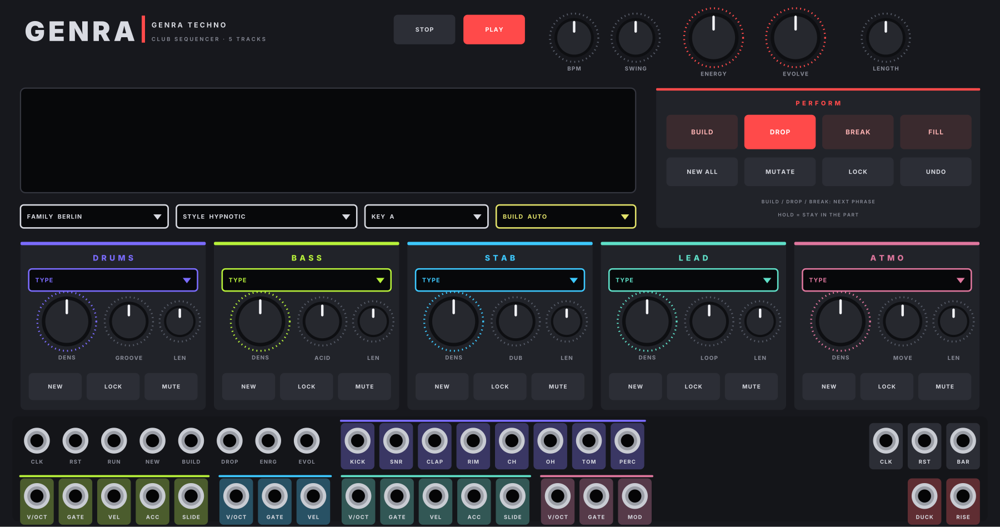

# GENRA TECHNO

A VCV Rack 2 plugin by Bastian Ofner, part of the GENRA family: a generative sequencer for techno and club music,
with its own grid editor, song arranger and song modulation. It only sends notes, gates and CV; the sounds come from
the instruments you patch (GENRA Instruments or any other module).

## The modules

| Module | HP | What it does |
|---|---|---|
| **GENRA TECHNO** | 48 | The generator and player: 22 styles, five tracks, a whole song made live |
| **GENRA TECHNO GRID** | 44 | The editor: drum raster and piano roll, velocity, chance, ratchets, loop length per track |
| **GENRA TECHNO ABLAUF** | 34 | The song arranger: 64 pattern pads, variations per part, a song list, MAKE SONG |
| **GENRA TECHNO MOD** | 30 | Four CV lanes that move with the song (filter sweeps, sends, levels …) |

GRID, ABLAUF and MOD connect to GENRA TECHNO without cables (automatically to the first one in the patch;
right-click › Connect to …).

## GENRA TECHNO

- **Styles** in eight families: DETROIT (Classic, Soul), BERLIN (Hypnotic, Minimal, Dub Techno, Warehouse, Peak Time),
  ACID (Acid Techno, Acid House), HARD (Hard Techno, Industrial, Schranz), MELODIC (Melodic Techno, Progressive House),
  HOUSE (Tech House, Deep House, Chicago House), TRANCE (Trance, Progressive Trance, Psytrance), ELECTRO (Electro,
  Breaks). Every style has its own harmony: STATIC (one chord), MODAL (two chords) or PROGRESSION (a chord every bar).
- **Five tracks**: DRUMS (8 voices in GENRA's order: kick, snare, clap, rim, closed hat, open hat, tom, perc), BASS,
  STAB (poly 4), LEAD and ATMO (poly 4). Per track: a TYPE (e.g. ACID 303, DUB CHORD, HYPNO LOOP), DENS, a flavour
  knob (GROOVE, ACID, DUB, LOOP, MOVE), LEN (the track's own loop length in 16ths: polymeter), NEW, LOCK and MUTE.
- **Better patterns**: for every track the generator makes several candidates and keeps the one the rules like best
  (kick and bass apart, enough repetition, chord tones on the strong beats …).
- **LIVE song**: without ABLAUF (or with ABLAUF in PATT mode) GENRA TECHNO makes the whole song itself: intro, groove,
  build, drop, break, build, drop, outro, as long as LENGTH says (2–12 minutes). One element changes every 8 bars;
  intro and outro are drums only (DJ-friendly).
- **Builds** (BUILD: AUTO picks what the style likes, or choose one): snare roll, kick, hat roll, arp, stutter, strip,
  poly, cut, none, fake. The second build and drop are bigger (GROW: longer, faster rolls, a moment of silence before
  the drop, more percussion, the lead an octave up in melodic styles).
- **PERFORM**: BUILD, DROP and BREAK go there at the start of the next phrase (8 bars); hold the key to stay in that
  part. FILL plays a fill at the end of the bar. NEW ALL, MUTATE, LOCK (all tracks), UNDO.
- **ENERGY** thins out or fills up hats, ghosts and percussion; **EVOLVE** changes one track a little every 8 bars.
- **Outputs**: 8 drum triggers (level = velocity), BASS and LEAD (V/OCT, GATE, VEL, ACC, SLIDE), STAB (V/OCT and
  GATE poly 4, VEL), ATMO (V/OCT and GATE poly 4, MOD), CLK, RST, BAR, DUCK (a sidechain envelope on every kick) and
  RISE (0–10 V over a build).
- **Inputs**: CLK (16ths), RST, RUN, NEW, BUILD, DROP, ENERGY and EVOLVE CV.
- Right-click: export the pattern or the LIVE song as MIDI (into the MIDI folder of the GENRA plugins).

## GENRA TECHNO GRID

Pick a track (DRUMS … ATMO). Click: add or select a note; right-click: delete; drag a note: its length; click in the
ruler: the END of the track's loop. Under the roll: velocity and chance (drag), ratchets (click: 1–4). VIEW: BAR,
ZOOM (1/2/4 bars), PITCH, ALL · SCALE · USED. NOTES: VEL, LEN, CHANCE, RATCH, ACCENT, SLIDE, SNAP (only scale notes),
FOLLOW (the page follows the playhead). EDIT: UNDO, REDO, CLEAR, COPY, PASTE, NEW TRACK. SOLO plays only this track.
REC writes MIDI notes at the playing step (right-click › MIDI input).

## GENRA TECHNO ABLAUF

- **PATTERNS**: tap an empty pad to store what GENRA TECHNO plays; tap a pad to load it (PATT mode). VARIATION
  INTRO … OUTRO makes a variant of the last pattern for that part on the next free pad (press again: another one).
  COPY (from, to), CLEAR (then a pad), CLEAR ALL (press twice; UNDO brings it back). Right-click a pad: MIDI export.
- **SONG**: the rows (pad, bars, part, build). ROW picks a row, PAD, BARS and PART change it; INSERT puts the last pad
  after it, DELETE, UNDO, LOOP (the selected row repeats). FORM + MAKE SONG builds a song in a club form from the pads.
  DJ IN/OUT: intro and outro drums only. PLAY plays the song from the selected row (SONG mode), STOP stops.
  EXPORT SONG / EXPORT PAD write MIDI.
- Inputs: RUN, RST, NEXT, PAD CV, ROW CV. Outputs: END, ROW, PART (0–5 V), BUILD (gate), DROP, PHRASE.

## GENRA TECHNO MOD

Four lanes (A–D). For every part (INTRO … OUTRO) and lane one movement: OFF, LOW, MID, HIGH, RISE, FALL, SWELL, FADE,
WAVE, PUMP, WANDER, STEPS, JUMP, DIP (click: next; mouse wheel; right-click: the list). Per lane: DEPTH, SMOOTH (glide
between the parts), TARGET (only a name for the display), BARS (speed of WAVE), UNI (0–10 V) / BI (±5 V). GROW: later
drops bigger; CHORD: a little lift on every chord change; FREEZE: hold. Presets in the head.

MOD follows the song GENRA TECHNO plays: ABLAUF's when ABLAUF is in SONG mode, else the LIVE song. Without a GENRA
TECHNO it counts its CLK input (16ths) and takes the part from PART (0–5 V). The display shows the whole song, the
four lanes over it and where the song is.

## Building

Windows and Mac builds come from GitHub Actions (Actions › the latest run › Artifacts). By hand:
`make RACK_DIR=/path/to/Rack-SDK dist`. The engine has its own test: `g++ -std=c++11 test/tg_test.cpp src/tg/Engine.cpp`.

## License

GPL-3.0-only. `src/link/` and `src/MidiFolder.*` are copied from the GENRA plugin (same author, same license).
